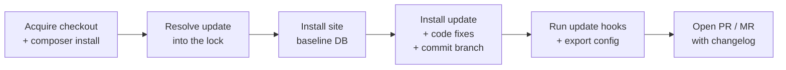

# How a run works

Drupdater operates on a **single working directory** of its own — a linked worktree of the
checkout your CI already provides, or a fresh clone with `--clone`. Old and new code live
there sequentially. There is no second copy and no side-by-side comparison, and the
checkout itself is never changed.

## The nine phases

Phases run linearly. Their names are exactly the strings that appear in the [run
report](../reference/run-report.md)'s `phases` list.

### 1. `acquire working copy`

Adds a [linked worktree](https://git-scm.com/docs/git-worktree) of the existing checkout in
a temporary directory, detached at the checkout's `HEAD` — or, with `--clone`, clones into a
temporary directory.

The worktree shares the checkout's history but has its own files and its own `HEAD`, so
nothing the run does reaches the checkout: not its branch, not its working tree, not its
untracked files. A worktree holds only tracked files, which is why the next phases install
`vendor/` there from scratch, just as in a clone.

Every git operation runs the `git` CLI, which the Docker image includes. Each command
overrides, for itself alone, the configuration that belongs to the project's developers
rather than to a run:

- `-c safe.directory=*`: a checkout mounted into the container belongs to another user,
  which git would otherwise refuse as "dubious ownership".
- `-c core.hooksPath=/dev/null`, plus `--no-verify` on commit and push: the project's hooks
  are for its developers' commits, and a failing one would block the run's.
- `-c commit.gpgSign=false`: a signing setup needs a key the CI runner does not have.

Nothing is written to any git config for any of it.

Commits are signed explicitly — the platform's user, else the identity git config supplies,
else `drupdater <drupdater@localhost>` — so drupdater writes nothing into the repository's
git config.

This is a recorded phase rather than setup because a bad token, an unreachable host or an
unreadable checkout is one of the most common real failures — and a failure here should be
as visible in the report as one during the update itself.

### 2. `preflight`

Runs three checks: full git history, the Drupdater agent's presence in Composer, and PHP
platform requirements, which the agent answers. These are the same functions [`drupdater
check`](../reference/cli/check.md) uses, so a shallow checkout is caught identically in both.

They run here — before anything expensive — because each failure is certain rather than
probable. A shallow checkout *will* fail at push time, several minutes later, with a
message that does not mention shallowness.

### 3. `composer install`

Installs the current dependency tree, establishing the "before" state.

### 4. `resolve update`

Settles what the update changes and what its branch will be called, while touching only
`composer.json` and `composer.lock`:

1. Fire **`pre-composer-update`**. Each addon returns a proposal for the update plan, and the
   runner [merges them](addon-architecture.md#steering-the-update-through-proposals) —
   [`composer_audit`](../reference/addons/composer-audit.md) restricts a `--security` run to
   the vulnerable packages, or aborts it when there are none;
   [`composer_patches`](../reference/addons/composer-patches.md) pins packages whose
   patches cannot be made to apply.
2. Run `composer update --no-install` with those constraints. It resolves the update and
   bumps the constraints in `composer.json`, but leaves `vendor/` at the old code. It runs
   through the [Drupdater agent](../reference/docker-images.md#drupdater-agent)'s
   `drupdater:resolve`, which calls Composer's own `update` command in-process, plugins and
   scripts included, then compares the lock it read before with the one Composer wrote. What
   changed comes from that comparison, not from Composer's console output. **If nothing
   changed, the run aborts here.**
3. Compute the branch name from the resolved `composer.lock` (see
   [below](#content-addressed-branch-names)), and **abort if it already exists**, locally
   or on the remote.

The run commits on its detached `HEAD`. No branch exists until the
[`site update`](#7-site-update) phase has made the last commit.

This phase comes before the baseline install because every way a run can find it has
nothing to do is decided here. A nightly job on an up-to-date site, or a re-run while the
previous request is still open, stops after one `composer update` instead of installing
every site first.

### 5. `baseline site install`

Installs each configured site via Drush, at the **old** code, building a baseline
database. `vendor/` still holds it: the update so far exists only in the lock.

This is what makes the update hooks in phase 7 meaningful. Running `updatedb` requires a
database at the pre-update schema; without a baseline there would be nothing for the
hooks to update, and no way to discover which hooks the update introduces.

The database is SQLite, in a directory of the system temp dir that belongs to this run.
Drupal reads its database settings only from `settings.php`, so Drupdater appends a
block pointing there, and cuts it off again as soon as the install finishes. The same
happens around the site update in phase 7. Every commit names its paths, so the appended
block is never staged, and the run ends with `settings.php` byte-for-byte as the project
has it.

Sites are installed concurrently, limited by `--concurrency`.

### 6. `update shared code`

The centre of the run:

1. Run `composer install`, bringing `vendor/` to the lock resolved in phase 4. Patches and
   scaffolding are applied here.
2. Fire **`post-composer-update`** — the dependency diff and normalisation.
3. Commit `composer.json` and `composer.lock`, together with anything else the update
   rewrote that git already tracks — `drupal-scaffold` owns files in the web root such as
   `.htaccess`, `robots.txt` and `index.php`, and a core update changes them. Untracked
   paths are left alone: `vendor/`, `web/core` and the site's generated files belong to
   nobody.
4. Fire **`post-code-update`** — Rector, PHPCBF, and the post-update security audit.

### 7. `site update`

The sites are updated in two steps, the second starting once every site has finished the
first:

1. **Concurrently, across sites:** configure the database, read the site's facts, fire
   **`pre-site-update`**, run the update hooks, resave configuration and read the facts
   again. This step touches only the site's database.
2. **One site at a time, in `--sites` order:** fire **`post-site-update`**, export
   configuration, and commit the site's config sync directory as `Update configuration
   <site>`.

Then every site's `settings.php` is put back.

The facts are everything drupdater reads from a site, gathered by one call to its own
`drupdater:facts` Drush command, which ships inside the binary and is loaded with `drush
--include`: the config sync directory, the translation path, the enabled modules, the pending
update hooks and the unsupported modules. One Drupal bootstrap per site answers all of them,
under Drush's update kernel, because the code is already updated and the schema is not. Both
site events carry them: `pre-site-update` the facts from before the update hooks,
`post-site-update` the ones read after them, without the drupal.org request for unsupported
modules. The config export is committed from the directory the second read names.

The second step writes into the working tree. Sites share that working tree and its git
index, and two sites can name the same config or translation directory, so it is a plain
loop. The slow database work still overlaps, and the commits come out in the same order on
every run, whichever site finishes first.
Drupdater commits the export itself rather than letting `drush config:export --commit` run
git, so no git hook or git-config identity is involved.

Once every site is done, the update branch named in phase 4 is pointed at the result. Only
now, because the run commits on a detached `HEAD`: a branch created earlier would not follow
the configuration commits.

### 8. `render merge request`

Render the title and description from the [run report](../reference/run-report.md) as
it stands, every addon's section included. A security run is titled by its date, a normal
one by its month.

This is a phase of its own, ahead of `publish`, so that it happens under `--dry-run` too.
The description is the run's only human-readable account of itself, and both title and
description are recorded in the [run report](../reference/run-report.md#merge-request-content)
whether or not a request is opened — so a dry run can be reviewed, and a broken template
fails there instead of surfacing on a real run that has already pushed.

### 9. `publish`

**Skipped entirely under `--dry-run`.**

Push the branch and create the request with the title and description rendered in phase 8.

If creating the request fails after the push succeeded, the just-pushed remote branch is
deleted on a best-effort basis — otherwise a failed run would leave an orphan branch that
the next run's name check would then trip over.

Finally, if the active run type asks for it, auto-merge is requested. A failure here is
logged and recorded but does not fail the run.

## Content-addressed branch names

The update branch is named `update-<hash>`, where the hash is the `content-hash` of
`composer.lock` as `composer update` resolved it — before any addon rewrites
`composer.json`, so that it is known before a single site is installed.

This makes the name a function of the *outcome*, not of the time. Two runs that produce
identical dependencies produce the same branch name — so the second one detects the branch
already exists and aborts rather than opening a duplicate request.

## "Nothing to do" is a success

Three conditions stop a run early, all three in the `resolve update` phase, before any site
is installed. All three exit `0`:

| Condition | Message |
|---|---|
| `composer update` changed nothing | `no changes detected` |
| The update branch already exists | `branch update-… already exists, skipping` |
| A `--security` run found no advisories | `No security advisories found` |

Internally these raise an abort signal that is logged as a warning rather than an error,
and sets the report's `status` to `no_changes`.

The alternative — treating them as failures — would mean a nightly security job on a
healthy site goes red every night, which trains everyone to ignore it.

## Failure and cleanup

Every run registers its cleanup before it starts work, so it runs on every exit path
including a timeout or `SIGTERM`.

**The report is written last.** Its deferred write is registered first, which in Go means
it runs last — so the report reflects everything that happened, including failures during
other cleanup.

**The worktree is removed on every exit path**, together with its temporary directory, so
whatever a failed run left half-done — the temporary `"*": true` `allow-plugins` rule
[`composer_allow_plugins`](../reference/addons/composer-allow-plugins.md) adds, say — goes
with it. The checkout was never touched, so there is nothing to restore. A removal that
fails is logged, never returned: it must not change the run's outcome.

**A failed run removes the update branch it created.** Left behind, it would make the next
run stop as if the update were already done.

**Site artefacts are removed.** Each site's SQLite database and private files live in
one temporary directory of the run's own, removed whole when the run ends. Nothing is
written beside the checkout, so a project's real `private/` directory is never touched.

In clone mode the clone's temporary directory is removed instead, guarded by a check that
it really is inside the system temp directory.

## Concurrency

Per-site work fans out with a limit of `--concurrency`, defaulting to `GOMAXPROCS(0)` —
which reflects the container's CPU quota rather than the host's core count.

The first site to fail cancels the rest, and no site writes into the working tree: the
second step only starts once every site's database update has succeeded. Sites are not updated independently; the point is a
single coherent request covering all of them.
